# 🚀 UniStudy Hub — Guia Oficial de Acesso, Testes e Manual de Funcionalidades

> **Documento Oficial de Demonstração, Testes de Equipe e Avaliação Acadêmica**  
> *Versão:* 2.0 (Atualizada com Suporte a Rede Local, Painel Admin Online e Guia Passo a Passo de Todas as Abas)  
> *Data de Atualização:* Novembro de 2026

---

## 📌 1. Onde Abrir e Como Acessar a Plataforma

Para que você, os parceiros do grupo e o instrutor consigam testar o sistema simultaneamente em qualquer lugar (computador, notebook ou celular), utilize os endereços abaixo:

### 🌐 A. Acesso Online em Produção (Vercel + Render + Neon) — ⭐ RECOMENDADO
O sistema já está hospedado e disponível online na nuvem 24 horas por dia, acessível por qualquer pessoa em qualquer lugar:

* **Site Oficial / Login (Vercel):** [https://uni-study-4wyp.vercel.app/login](https://uni-study-4wyp.vercel.app/login)
* **Link Direto da Plataforma:** [https://uni-study-4wyp.vercel.app/](https://uni-study-4wyp.vercel.app/)

> **Arquitetura da Nuvem em Produção:**
> * **Frontend:** Hospedado e distribuído globalmente na **Vercel** com suporte a PWA e renderização SPA.
> * **Backend (API REST & WebSockets):** Hospedado na nuvem **Render.com** (Python 3.12 + Django REST Framework + Gunicorn/Daphne).
> * **Banco de Dados:** Servidor PostgreSQL Cloud gerenciado de alta performance no **Neon.tech**.

---

### 💻 B. Acesso no Próprio Computador onde o Projeto está Rodando (Local)
* **Frontend (Aplicação Completa do Aluno/Professor):** [http://localhost:5173/](http://localhost:5173/)
* **Backend (API REST Django):** [http://localhost:8001/api/](http://localhost:8001/api/)
* **Painel Administrativo do Django:** [http://localhost:8001/admin/](http://localhost:8001/admin/)

---

### 📱 C. Acesso para Parceiros no Mesmo Wi-Fi / Rede Local (LAN)
Qualquer integrante ou avaliador conectado à **mesma rede Wi-Fi** pode abrir o sistema no celular, tablet ou notebook:
* **Frontend para Parceiros:** `http://192.168.15.64:5173/`
* **API e Painel Admin para Parceiros:** `http://192.168.15.64:8001/admin/`

> [!TIP]
> A API do frontend possui detecção dinâmica de host: se o parceiro acessar por `192.168.15.64:5173`, as requisições irão automaticamente para `192.168.15.64:8001`, sem necessidade de reconfiguração manual!

---

## 🛡️ 2. Como Acessar o Painel de Administrador

O UniStudy Hub conta com o **Django Admin**, um painel corporativo completo onde o administrador pode inspecionar o banco de dados, aprovar pedidos de docentes, alterar pontuações de XP, criar selos e moderar conteúdos.

### Passo a Passo para Acessar:

1. **Acesso Direto pelo Navegador:**
   * Acesse: **[http://localhost:8001/admin/](http://localhost:8001/admin/)** (ou `http://192.168.15.64:8001/admin/` na rede local).
2. **Acesso com 1 Clique por Dentro da Plataforma React:**
   * Faça login com qualquer conta de Administrador (ex: `prof_Renan` ou `admin`).
   * Vá até a aba **"Meu Perfil"** no menu lateral.
   * No topo direito, clique no botão roxo com ícone de escudo **"Admin"**. Ele abrirá diretamente o painel em uma nova aba!
   * Alternativamente, clique na foto do usuário no rodapé da barra lateral esquerda e selecione **"Painel Admin"**.

### Credenciais de Administrador (Superusuário):
| Usuário | E-mail Cadastrado | Senha | Integrante / Função | Privilégio |
| :--- | :--- | :--- | :--- | :--- |
| **admin** | `admin@unistudy.edu` | `admin` | Administrador Geral do Sistema | Superuser Total |
| **prof_Renan** | `rsdepaula2014@gmail.com` | `123456` | Renan de Paula (Líder / Admin) | Superuser Total |
| **matheus** | `matheus@unistudy.edu` | `123456` | Matheus (Integrante) | Superuser Total |
| **suedson** | `suedson@unistudy.edu` | `123456` | Suedson (Integrante) | Superuser Total |
| **milly** | `milly@unistudy.edu` | `123456` | Milly (Integrante) | Superuser Total |
| **larissa** | `larissa@unistudy.edu` | `123456` | Larissa (Integrante) | Superuser Total |
| **davi** | `davi@unistudy.edu` | `123456` | Davi (Integrante) | Superuser Total |
| **diego** | `diego@unistudy.edu` | `123456` | Diego (Integrante) | Superuser Total |

> [!NOTE]
> **Flexibilidade de Login:** Em qualquer tela de autenticação da plataforma, você pode entrar informando tanto o **Nome de Usuário** quanto o **E-mail**.

---

## 👥 3. Contas Intercaladas para Testes de Papéis (Professor vs. Aluno)

Para demonstrar as regras de permissão, criador de quizzes, moderação de dúvidas e concessão de selos, utilize estas contas de teste:

| Usuário | E-mail | Senha | Papel | XP Inicial | O que pode testar no sistema |
| :--- | :--- | :--- | :--- | :--- | :--- |
| **matheus_aluno** | `matheus.aluno@unistudy.edu` | `123456` | **Estudante** | 450 XP | Responder quizzes, enviar dúvidas, pedir selo docente |
| **prof_suedson** | `suedson.prof@unistudy.edu` | `123456` | **Professor** | 1500 XP | Criar Quizzes com selo automático, validar soluções |
| **milly_aluna** | `milly.aluna@unistudy.edu` | `123456` | **Estudante** | 380 XP | Comprar na Loja de XP, participar de guildas |
| **prof_larissa** | `larissa.prof@unistudy.edu` | `123456` | **Professora** | 1400 XP | Criar Quizzes, conceder selos, moderar fórum |
| **davi_aluno** | `davi.aluno@unistudy.edu` | `123456` | **Estudante** | 520 XP | Testar cronômetro da Sala de Foco e exportar CV |
| **prof_diego** | `diego.prof@unistudy.edu` | `123456` | **Professor** | 1600 XP | Validação de respostas verificadas no Fórum |

---

## 🧭 4. Roteiro Visual Completo: Todas as Páginas em Ordem (com Imagens Dark e Passo a Passo)

Abaixo está o roteiro pedagógico completo, organizado na ordem cronológica exata de uso da plataforma (desde o primeiro acesso na tela de login até as configurações de perfil e administração), incluindo a captura de tela oficial em modo Dark, a descrição da página e o passo a passo de como os colegas de equipe e o instrutor podem utilizá-la:

---

### 🔐 1. Tela de Login e Boas-Vindas
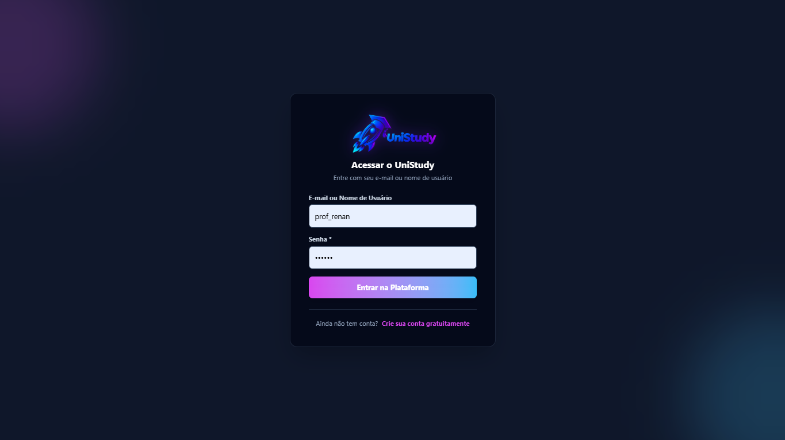

* **Descrição da Página:**  
  É a porta de entrada segura do ecossistema UniStudy Hub. Permite a autenticação de estudantes, professores e administradores através de tokens JWT criptografados. Também oferece atalho para alternar o tema visual (Dark/Light) e botão para criar uma nova conta.
* **Como Utilizar Passo a Passo:**
  1. Digite seu **Nome de Usuário** (ex: `prof_Renan`, `admin`, `matheus_aluno`, `prof_suedson`) ou o seu **E-mail cadastrado**.
  2. Digite a senha correspondente (para a maioria das contas de teste a senha é `123456`; para o admin geral é `admin`).
  3. Clique em **"Entrar no UniStudy Hub"**.
  4. O sistema autenticará suas credenciais e redirecionará você instantaneamente para o Dashboard Principal com seu nível, avatar e XP carregados.

---

### 🏠 2. Aba "Início" (Dashboard Principal & Resumo do Estudante)
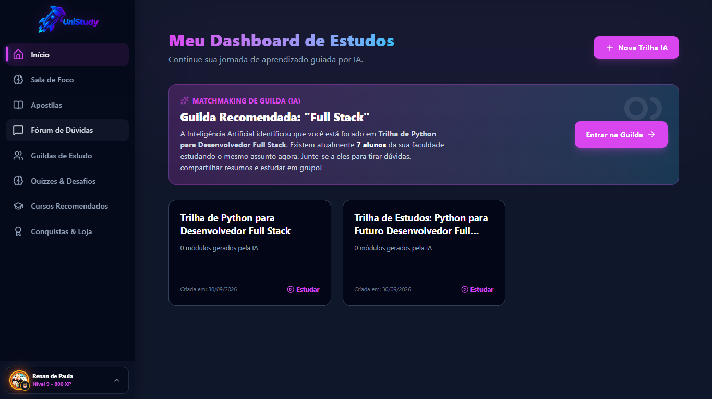

* **Descrição da Página:**  
  O centro de comando do estudante e do docente. Reúne em uma única tela os principais indicadores acadêmicos: ofensiva de estudos diária (dias seguidos estudando), total de apostilas lidas, dúvidas acadêmicas respondidas e saldo total de XP acumulado.
* **Como Utilizar Passo a Passo:**
  1. **Visualizar Indicadores:** Confira nos cartões superiores suas estatísticas de aprendizado e sua sequência de dias consecutivos estudando.
  2. **Usar Atalhos Rápidos:** Clique nos botões de acesso direto para entrar na Sala de Foco, responder ao Quiz da semana ou consultar as dúvidas mais recentes no Fórum.
  3. **Conferir Perfil na Barra Lateral:** No rodapé do menu esquerdo, confira seu avatar com a **moldura neon equipada**, seu **selo de conquista ativo** e sua barra de nível atual.

---

### 🗺️ 3. Aba "Guia de Estudos" (Trilhas de Aprendizagem Adaptativas)
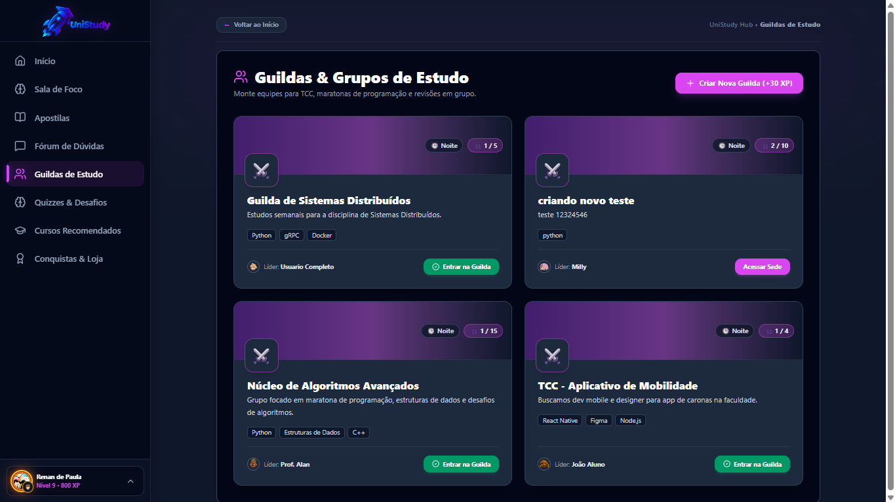

* **Descrição da Página:**  
  Apresenta as trilhas de conhecimento estruturadas de forma sequencial e pedagógica. O estudante pode progredir módulo por módulo, absorvendo conceitos teóricos antes de ser avaliado na prática.
* **Como Utilizar Passo a Passo:**
  1. **Escolher uma Trilha:** Selecione o tema que deseja dominar (ex: *Lógica de Programação*, *Engenharia de Software*, *Banco de Dados*).
  2. **Acompanhar o Progresso:** Cada trilha exibe uma barra de porcentagem de conclusão e a contagem de etapas já concluídas.
  3. **Avançar nos Módulos:** Clique nos módulos disponíveis para abrir as leituras recomendadas e os exercícios de fixação, acumulando XP a cada etapa finalizada.

---

### 🧠 4. Aba "Quizzes & Desafios" (Gamificação com Selos Bronze, Prata e Ouro)
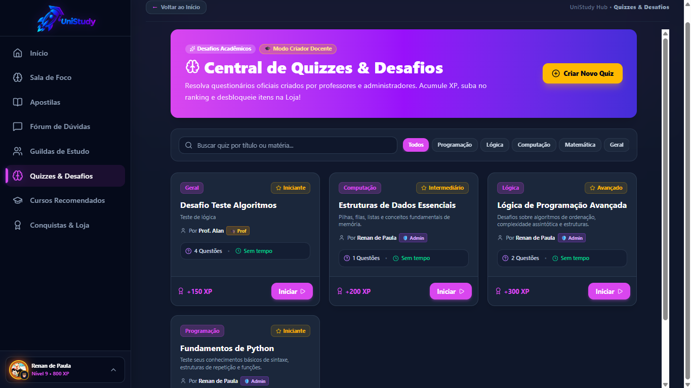

* **Descrição da Página:**  
  Ambiente interativo de verificação de aprendizagem com perguntas de múltipla escolha, temporizador dinâmico e distribuição automática de selos de mérito acadêmico.
* **Como Utilizar Passo a Passo (Como Aluno):**
  1. Escolha qualquer quiz disponível na lista (exibindo matéria, nível de dificuldade e XP de recompensa).
  2. Responda às perguntas antes do tempo se esgotar. O sistema calcula a sua taxa de acerto instantaneamente.
  3. **Conquista Automática de Selos:**
     * **Abaixo de 50%:** Ganho de XP de participação.
     * **50% a 69%:** Conquista imediata do **Selo de Bronze 🥉**.
     * **70% a 99%:** Conquista imediata do **Selo de Prata 🥈**.
     * **100% (Gabarito perfeito):** Conquista imediata do lendário **Selo de Ouro 🥇**!
* **Como Utilizar Passo a Passo (Como Professor ou Admin):**
  1. Faça login com conta docente e clique no botão roxo **"+ Criar Novo Quiz"**.
  2. Preencha o título, matéria e selecione o **Emoji do Selo** e o **Nome da Conquista** (o sistema vincula automaticamente os 3 níveis de insígnias).
  3. Cadastre as perguntas, alternativas e marque o gabarito correto. Ao salvar, o quiz fica disponível para toda a universidade.

---

### ⏱️ 5. Aba "Sala de Foco" (Técnica Pomodoro & Sons Ambientes)
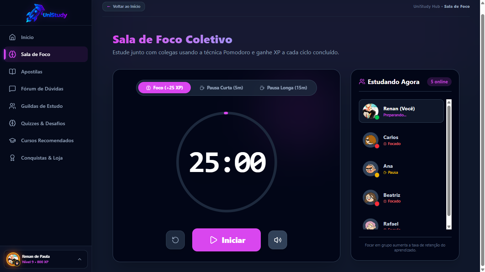

* **Descrição da Página:**  
  Espaço de produtividade acadêmica livre de distrações projetado para estudos profundos (*Deep Work*), combinando temporizador Pomodoro configurável com sons ambientes e co-working em tempo real.
* **Como Utilizar Passo a Passo:**
  1. **Definir o Ciclo Pomodoro:** Escolha entre *Foco (25 min)*, *Pausa Curta (5 min)* ou *Pausa Longa (15 min)* e clique em **Iniciar**.
  2. **Ligar os Sons Ambientes:** Na barra lateral da sala, ative os sons relaxantes (*Chuva Suave, Cafeteria Universitária, Fogueira Aconchegante e Ruído Branco*) com controle independente de volume.
  3. **Co-working Virtual:** Observe a lista lateral com os colegas de classe que também estão estudando no momento e veja seus status em tempo real.
  4. **Ganho de XP:** Ao completar os ciclos de concentração, seu perfil recebe pontos de XP de dedicação.

---

### 📚 6. Aba "Apostilas" (Biblioteca Didática Digital & Leitor Imersivo)
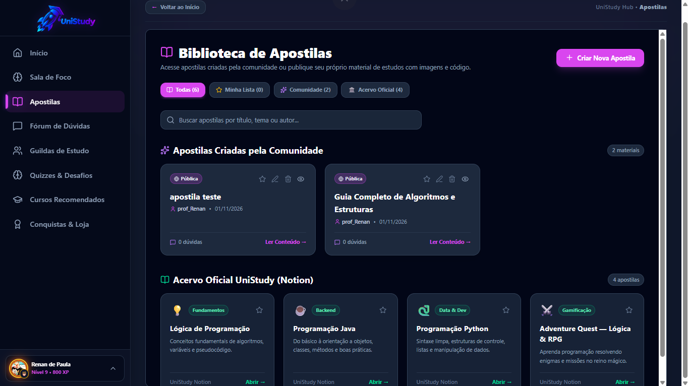

* **Descrição da Página:**  
  Biblioteca acadêmica centralizada com resumos didáticos, artigos e apostilas técnicas criadas por professores e estudantes, com formatação rica em Markdown.
* **Como Utilizar Passo a Passo:**
  1. **Buscar Conteúdo:** Utilize a barra de pesquisa ou os filtros de matérias para localizar o conteúdo desejado.
  2. **Abrir Leitor Imersivo:** Clique no card de qualquer apostila para entrar no modo de leitura fluida.
  3. **Personalizar Leitura:** Ajuste o tamanho da tipografia (zoom), ative o modo sepia/dark e navegue pelo sumário dinâmico na lateral.
  4. **Oráculo IA:** No leitor, utilize o botão do Oráculo com IA para resumir o material, gerar quizzes rápidos de autoavaliação ou tirar dúvidas sobre o texto.

---

### ✍️ 7. Criação & Edição Avançada de Apostilas (Tabelas 2x2, Imagens & VS Code)
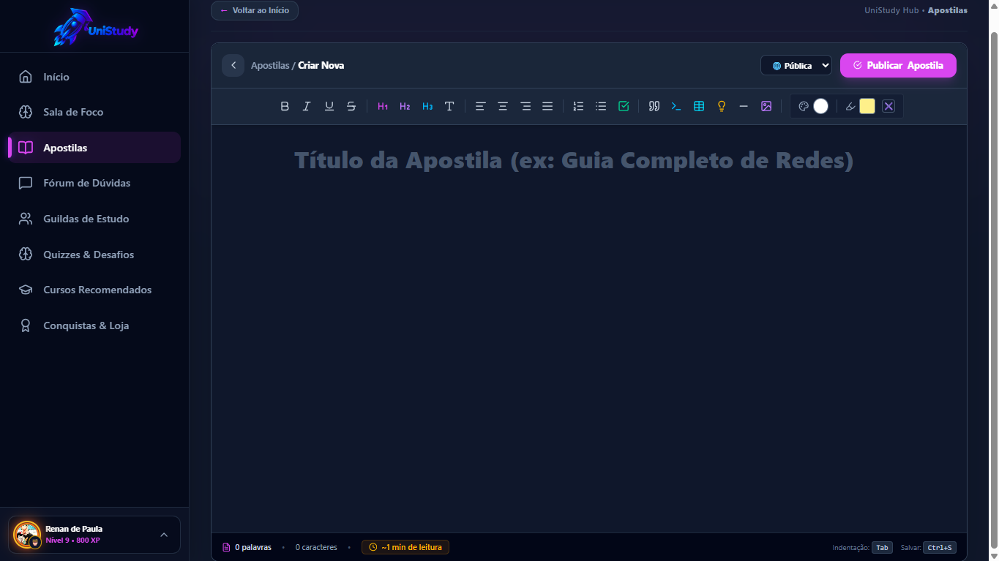

* **Descrição da Página:**  
  Editor de texto moderno com recursos completos de diagramação acadêmica, permitindo redigir conteúdos em tela dividida com tabelas interativas, inserção livre de imagens e blocos de código estilo VS Code.
* **Como Utilizar Passo a Passo:**
  1. Na aba Apostilas, clique em **"+ Criar Apostila"** (ou no lápis para editar uma apostila sua).
  2. **Inserir Tabela 2x2 com 1 Clique:** Clique no ícone de Tabela na barra de ferramentas e selecione o botão rápido **"Tabela 2x2"**. A tabela é criada com 2 colunas e 2 linhas!
  3. **Gerenciar Tabela Dinamicamente:** Clique em qualquer célula da tabela para exibir a Barra de Controle no topo, com botões para `+ Linha`, `+ Coluna`, `- Linha`, `- Coluna` ou `Excluir Tabela`.
  4. **Inserir Imagens com Alocação Livre:** Clique no ícone de Imagem (faça upload do seu computador ou informe um link). Ao clicar na imagem inserida, ajuste o tamanho pelo **slider contínuo (10% a 100%)** ou use as opções de alinhamento: *Esquerda*, *Centro*, *Direita* ou **◀ Flutuar à Esquerda / Flutuar à Direita ▶** (para o texto contornar ao lado da foto!).
  5. **Inserir Código no Estilo VS Code:** Clique no botão de Código IDE. Escolha a linguagem (JavaScript, Python, HTML/CSS, SQL, Java, C++, Bash), digite seu código, veja a prévia colorida em tempo real e insira no documento com visual idêntico ao VS Code e botão de copiar integrado.
  6. Clique em **"Publicar Apostila"** para salvar e disponibilizar para os colegas.

---

### 💬 8. Aba "Fórum de Dúvidas" (Comunidade & Soluções Verificadas)
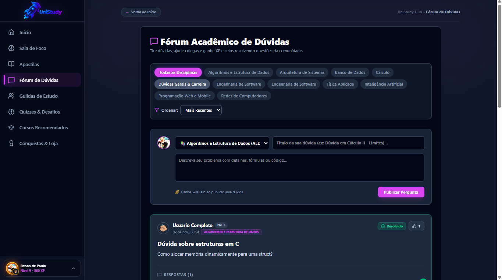

* **Descrição da Página:**  
  Ágora acadêmica universitária onde estudantes postam dificuldades sobre exercícios e matérias, e colegas ou docentes respondem com validação oficial de soluções.
* **Como Utilizar Passo a Passo:**
  1. **Publicar uma Dúvida:** Clique no botão **"Nova Pergunta"**, informe o título, selecione o curso/matéria, adicione tags e explique sua dúvida.
  2. **Votar e Interagir:** Clique nos botões de voto positivo (upvote) para destacar dúvidas pertinentes e soluções completas.
  3. **Responder com Código:** Utilize a caixa de resposta para ajudar colegas, com suporte a código e formatação técnica.
  4. **Selo de Solução Verificada (🎓):** Professores ou o próprio autor da dúvida podem marcar a melhor resposta como *Solução Oficial*, concedendo destaque verde e XP bônus a quem auxiliou.

---

### 🛡️ 9. Aba "Guildas de Estudo" (Grupos de Estudo & Chat Temático em Tempo Real)
* **Descrição da Página:**  
  Comunidades temáticas de colaboração onde estudantes se reúnem para trabalhos em grupo, preparação para provas e estudos coletivos com ranking conjunto.
* **Como Utilizar Passo a Passo:**
  1. **Entrar em uma Guilda:** Navegue pelas guildas ativas (ex: *Desenvolvimento Web*, *Cálculo e Física*, *Medicina*) e ingresse nas de seu interesse.
  2. **Conversar nos Canais do Chat:** Acesse os canais organizados dentro da guilda:
     * `#geral`: Notícias e alinhamento de tarefas.
     * `#duvidas`: Discussão de exercícios e dúvidas específicas.
     * `#offtopic`: Confraternização e bate-papo descontraído.
  3. **Ranking Coletivo:** Ao estudar e resolver tarefas, os integrantes somam XP conjunto para elevar a guilda ao topo do ranking acadêmico.

---

### 🎓 10. Aba "Cursos Recomendados" (Certificações & Extensão)
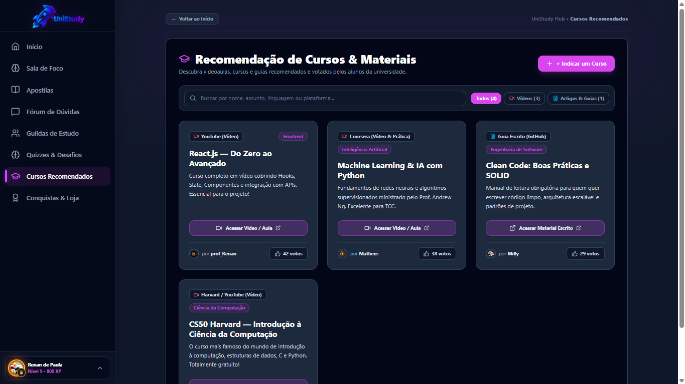

* **Descrição da Página:**  
  Catálogo curado de capacitações e certificações complementares avaliadas pela comunidade universitária para fortalecer o currículo acadêmico.
* **Como Utilizar Passo a Passo:**
  1. Navegue pelos cursos com dados de carga horária, nível de dificuldade e avaliações em estrelas.
  2. Clique nos links para acessar as páginas oficiais das instituições parceiras e realizar a matrícula.
  3. Compartilhe recomendações de cursos que ajudaram na sua formação para apoiar seus colegas de classe.

---

### 🏆 11. Aba "Conquistas & Ranking" (Galeria de Selos & Líderes por XP)
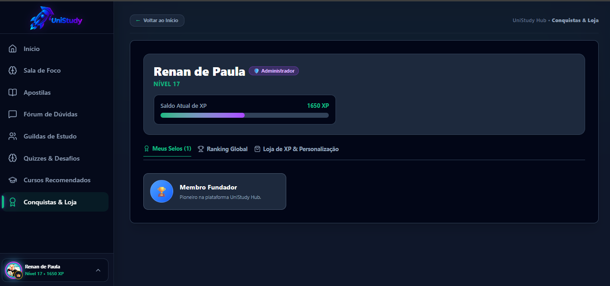

* **Descrição da Página:**  
  Centro de reconhecimento acadêmico da plataforma. Exibe todas as insígnias e selos desbloqueados e a classificação geral dos estudantes pelo acúmulo de XP.
* **Como Utilizar Passo a Passo:**
  1. **Sub-aba "Meus Selos":** Veja todos os selos de Bronze, Prata e Ouro conquistados em quizzes e desafios práticos.
  2. **Sub-aba "Ranking Global":** Visualize a tabela de classificação em tempo real, conferindo a pontuação de XP, a **moldura neon** de cada estudante e o **selo de honra** equipado ao lado do nome.

---

### 🛍️ 12. Aba "Loja de XP" (Personalizações, Molduras Neon e Temas)
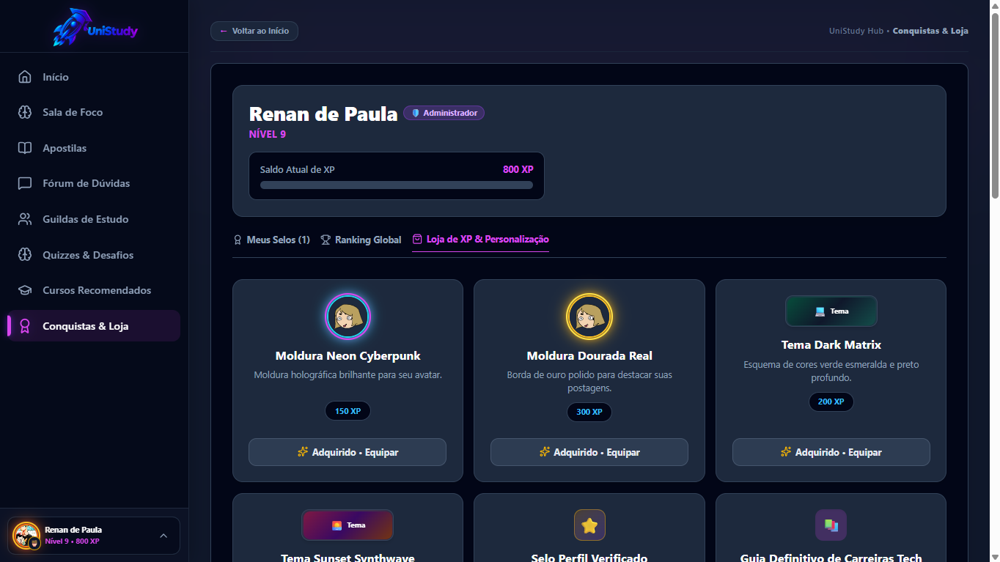

* **Descrição da Página:**  
  A loja de recompensas cosméticas do UniStudy Hub. O XP conquistado estudando é utilizado como moeda virtual para adquirir personalizações visuais exclusivas.
* **Como Utilizar Passo a Passo:**
  1. Navegue pelas 3 categorias de cosméticos:
     * **Molduras de Avatar (`AVATAR_FRAME`):** *Cyber-Volt Relâmpago*, *Neon Cyberpunk*, *Dourada Real*, *Chama Dracônica*, *Ametista Astral*, etc. (todas com efeitos neon e pulsos elétricos).
     * **Cores de Tema (`THEME_COLOR`):** *Cyberpunk Neon Tokyo*, *Dark Matrix*, *Sunset Synthwave*, *Cósmico Estelar* e *Floresta Esmeralda*.
     * **Selos de Perfil (`PROFILE_BADGE`):** *Coruja da Sabedoria* (`🦉`), *Café com Código* (`☕`), *Mestre dos Quizzes* (`👑`), etc.
  2. Compre o item desejado utilizando seu saldo de XP.
  3. Clique no botão verde **"Equipar"**: o item é ativado na hora e seu visual se reflete imediatamente no seu Perfil, na Sidebar lateral e no Ranking Global!

---

### 👤 13. Aba "Meu Perfil" (Identidade Acadêmica, Banner & Exportar CV em PDF)
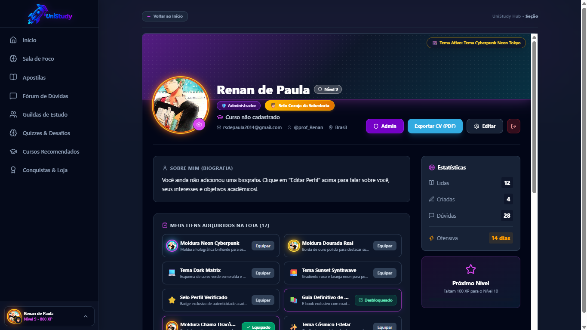

* **Descrição da Página:**  
  Painel de controle individual do aluno ou docente. Exibe o banner dinâmico com a iluminação do tema equipado, o avatar com a moldura neon, as informações do curso e o gerador de currículo acadêmico oficial.
* **Como Utilizar Passo a Passo:**
  1. **Visualizar Itens Equipados:** Confira sua moldura neon pulsante e a capa adaptada às cores do seu tema ativo na loja.
  2. **Editar Dados Pessoais:** Altere seu nome, curso, semestre atual e biografia acadêmica.
  3. **Exportar Currículo em PDF (1 Clique):** Clique no botão roxo **"Exportar CV (PDF)"** no topo direito. O sistema compila instantaneamente seu currículo oficial universitário pronto para impressão ou envio a recrutadores.
  4. **Solicitar Selo de Professor Verificado:** Se for estudante atuando como monitor ou docente, clique em **"Sou Professor"**, anexe seu comprovante/LinkedIn e submeta para validação no Admin.
  5. **Acessar Painel Admin (para Administradores):** Se logado como Administrador, o botão com escudo **"Admin"** aparece no topo direito permitindo entrar direto no backoffice do Django.

---

### ⚙️ 14. Painel Administrativo Django (`/admin/`) — Gestão Total do Sistema
* **Descrição da Página:**  
  O backoffice corporativo do UniStudy Hub. Permite aos gestores, professores líderes e coordenadores inspecionar e gerenciar todas as tabelas do banco de dados em tempo real.
* **Como Utilizar Passo a Passo:**
  1. Acesse pela URL direta [http://localhost:8001/admin/](http://localhost:8001/admin/) ou pelo botão roxo **"Admin"** dentro da aba Meu Perfil.
  2. Entre com a conta de administrador (ex: `admin` / `admin` ou `prof_Renan` / `123456`).
  3. **Gerenciar Solicitações Docentes (`Accounts > Solicitações de Professor`):** Analise os pedidos pendentes com links comprobatórios e mude o status para *APPROVED* (promovendo a conta instantaneamente a Professor) ou *REJECTED*.
  4. **Gerenciar Usuários e Saldos (`Accounts > Users`):** Ajuste pontuações de XP, promova privilégios de equipe e altere senhas.
  5. **Gerenciar Loja de XP (`Gamification > Store items`):** Cadastre novos itens cosméticos, molduras e temas visuais com seus respectivos preços em XP.
  6. **Inspecionar Quizzes e Gabaritos (`Gamification > Quizzes & Desafios`):** Modere perguntas, confira histórico de submissões e notas dos estudantes.

---

## 🛠️ 5. Como Iniciar o Projeto (Comandos para o Terminal)

Se precisar reiniciar os servidores em qualquer momento:

```powershell
# 1. Iniciar o Backend Django (Porta 8001):
cd "E:\UniStudy-trilha-unistudy1\backend"
.\venv\Scripts\activate
python manage.py runserver 0.0.0.0:8001

# 2. Iniciar o Frontend Vite React (Porta 5173 com acesso em rede):
cd "E:\UniStudy-trilha-unistudy1\frontend"
npm run dev
```

> Pronto! A plataforma estará ativa e pronta para testes locais e em rede por toda a sua equipe! 🎓✨
